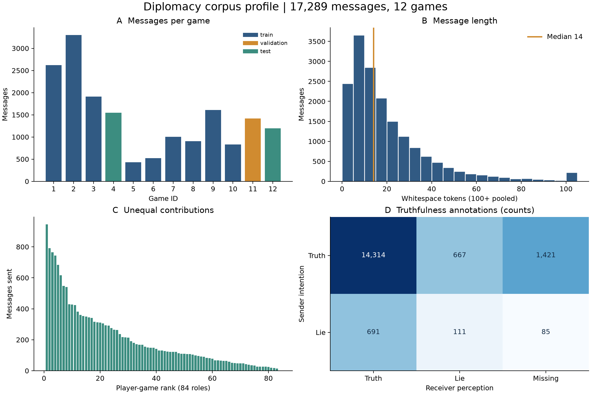
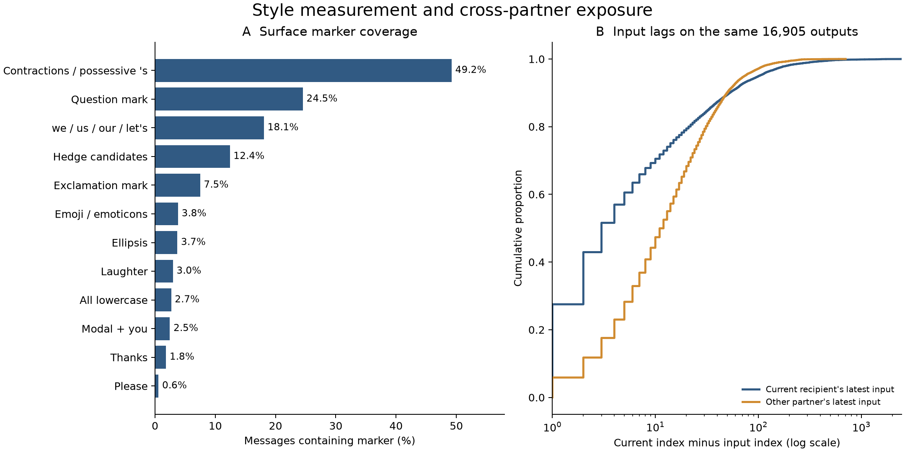

# 数据与先导分析

**更新日期：2026-11-12**
**合并自：** 数据概览（2026-11-09）、语料初步考察（2026-11-07）。两份文档中重复的统计只保留一次；口径不同的数字在正文中说明差异。

研究对象是**同一个人收到 A 的消息后，给 B 的后续表达是否向 A 靠拢**。第 1–10 节描述语料结构与表达分布，第 11 节是先导回归。所有数字都是描述统计或探索性结果，迁移效应需要[方法文档](02-method.zh.md)中的模型比较来估计。

## 1. 这些数据来自什么任务

Diplomacy 是七人策略游戏，玩家分别扮演 Austria、England、France、Germany、Italy、Russia 和 Turkey，通过私下谈判协调行动、建立联盟，也可能背叛。语料来自真实玩家的游戏内文字交流。作者收集了消息原文、收发双方、游戏内顺序，以及发送者自报的真诚意图和接收者对真诚程度的判断。玩家的目标和关系会随着局势变化，语言也包含请求、提议、情报、推测和简短回应。[Peskov 等，2020](https://aclanthology.org/2020.acl-main.353/)

对本项目，可以把每条 P → B 消息当成一次待预测的产出，把此前 A → P 和 B → P 的消息分别当成其他伙伴输入与当前伙伴输入。语料包含整局所有私信，因此可以重建每个人**直接收到的消息**，也能确定哪些消息 P 没有看到。间接转述、真实阅读时刻及玩家线下交流需要另外的记录才能核实。

## 2. 文件、游戏、对话与消息是四个层级

| 文件 | 游戏 ID | 游戏数 | JSONL 行数 | 非空双人对话 | 消息数 | 消息占比 |
| --- | --- | ---: | ---: | ---: | ---: | ---: |
| [train.jsonl](../../datasets/diplomacy/train.jsonl) | 1、2、3、5、6、7、8、9、10 | 9 | 189 | 184 | 13,132 | 76.0% |
| [validation.jsonl](../../datasets/diplomacy/validation.jsonl) | 11 | 1 | 21 | 20 | 1,416 | 8.2% |
| [test.jsonl](../../datasets/diplomacy/test.jsonl) | 4、12 | 2 | 42 | 42 | 2,741 | 15.9% |
| **总计** | 1–12 | **12** | **252** | **246** | **17,289** | **100%** |

百分比独立四舍五入。三份文件合计 3,208,706 字节，约 3.06 MiB，游戏 ID 互不重叠。SHA-256 与[数据来源说明](../../datasets/diplomacy/README.md)中的三个校验值全部一致。另有消息级 CSV 导出，见 [datasets/diplomacy/csv/](../../datasets/diplomacy/csv/README.md)。

**一行 JSONL 保存一场游戏中一对玩家之间的全部消息。** 例如 `players=["italy","germany"]` 这一行，可能有 Italy → Germany，也有 Germany → Italy。该行内部的多个数组按位置对齐，`messages[i]` 的发信人、收信人、标注和时间顺序都在相应数组的第 `i` 项。每局七个角色共有 21 个无向组合，12 局因此共有 252 行。6 行的消息数组为空，展开后得到 246 段非空双人对话。

消息级分析的主键是 `(game_id, absolute_message_index)`。

## 3. 字段字典与数据类型

| 原始字段 | 本地实际类型 | 具体含义及使用方法 |
| --- | --- | --- |
| `game_id` | 整数 | 游戏 ID。与国名组合后构成游戏内玩家身份 |
| `players` | 两个字符串的列表 | 本行的双人组合，方向由每条消息的收发字段确定 |
| `messages` | 字符串列表 | 原始消息，包含换行、缩写、标点、表情等 |
| `speakers` | 字符串列表 | 每条消息的发信角色 |
| `receivers` | 字符串列表 | 每条消息的收信角色 |
| `absolute_message_index` | 整数列表 | 本局所有对话合在一起的消息序号，从 0 开始 |
| `relative_message_index` | 整数列表 | 本行双人对话中的序号，从 0 开始 |
| `years` | 数字字符串列表 | 游戏内年份，如 `"1901"`，可转整数 |
| `seasons` | 字符串列表 | `Spring`、`Fall`、`Winter`，与年份共同描述游戏阶段 |
| `game_score` | 数字字符串列表 | 发信人当时的补给中心数，可转整数 |
| `game_score_delta` | 数字字符串列表 | 发信人分数减去收信人分数，可转整数 |
| `sender_labels` | 布尔列表 | `true` 表示发送者自报真诚，`false` 表示自报有欺骗意图 |
| `receiver_labels` | 布尔与字符串混合列表 | `true` 表示被认为真诚，`false` 表示被怀疑欺骗，`"NOANNOTATION"` 表示缺少判断 |

有两个转换细节需要保留。JSON 中的 `false` 是一个有效标注。`"NOANNOTATION"` 应在标注分析里单独处理，直接对该列做 `astype(bool)` 会把非空字符串转成真值，改变它的含义。上游说明有一处把分差简称为 `score_delta`，本地原文件实际使用 `game_score_delta`。[作者字段说明](https://github.com/DenisPeskoff/2020_acl_diplomacy/blob/c28c0870a639f6f388c87d4f8eaf685e64bfb1a6/data/README.md) · [ConvoKit 字段说明](https://convokit.cornell.edu/documentation/diplomacy.html)

展开后的一个真实例子如下。字段名采用原加载器转换后的形式。

```json
{
  "game_id": 1,
  "abs_index": 274,
  "speaker": "england",
  "receiver": "france",
  "text": "Ok I think that's all of my messages for now.",
  "years": "1901",
  "seasons": "Winter",
  "sender_labels": true,
  "receiver_labels": true
}
```

## 4. 每局规模及玩家身份

| 游戏 ID | 切分 | 消息数 | 有发言角色数 | 非空双人对话数 | 游戏年份范围 | 消息长度中位数 |
| ---: | --- | ---: | ---: | ---: | --- | ---: |
| 1 | train | 2,618 | 7 | 20 | 1901–1910 | 21 |
| 2 | train | 3,302 | 7 | 21 | 1901–1910 | 9 |
| 3 | train | 1,914 | 7 | 20 | 1901–1910 | 14 |
| 4 | test | 1,546 | 7 | 21 | 1901–1907 | 16 |
| 5 | train | 427 | 7 | 21 | 1901–1910 | 12 |
| 6 | train | 521 | 6 | 19 | 1901–1910 | 20 |
| 7 | train | 1,003 | 7 | 21 | 1901–1910 | 14 |
| 8 | train | 905 | 7 | 21 | 1901–1910 | 12 |
| 9 | train | 1,611 | 7 | 21 | 1901–1907 | 15 |
| 10 | train | 831 | 7 | 20 | 1901–1910 | 21 |
| 11 | validation | 1,416 | 7 | 20 | 1901–1910 | 14 |
| 12 | test | 1,195 | 7 | 21 | 1901–1910 | 12 |

这里的长度按空格分隔单元统计。游戏 1 和 2 合计占全部消息的 **34.2%**，同样进入汇总指标时，活跃游戏的影响更大。

**84 个游戏内角色位置中，有 83 个角色发过消息。** 游戏 6 的 Italy 收到 13 条消息，发出 0 条。国名会在不同游戏重复出现，数据支持识别 `1:england`、`2:england` 这样的游戏内身份，跨局真人对应关系需要额外身份信息。个人基线因此只能在局内建立，局初存在冷启动问题。ConvoKit 的 83 位 speaker 和 246 个 conversation，分别对应有发言的角色和非空对话。[ConvoKit 数据概况](https://convokit.cornell.edu/documentation/diplomacy.html)

83 个有发言的角色中，每人发信量的中位数为 **130 条**，最少 14 条、最多 945 条。包含沉默角色的 84 个位置，其收信量中位数为 145.5 条，范围为 13–863 条。71 个角色向全部六位其他玩家发过消息，11 个向五位发过，一位向三位发过。另有一位的发信伙伴数为零。

246 对非空双人对话的消息数中位数为 **30.5 条**，范围为 1–675 条。把 6 对空对话也计算在内，252 对的中位数为 29 条。存在消息的有向 `P → B` 关系共有 **484 个**。个人和伙伴关系的样本量差异，应进入基线估计与模型不确定性的解释。



图中 A 按官方切分着色。B 把 100 个及以上的空格分隔单元合并到最右侧。C 包含 84 个角色位置并按发信量排序。D 给出标注计数，底色用对数尺度，以便显示较小格子。

## 5. 文本有多长，包含什么

| 指标 | 空格分隔单元数 | 字符数 |
| --- | ---: | ---: |
| 最小值 | 1 | 1 |
| 第 5 百分位 | 2 | 10 |
| 第 25 百分位 | 7 | 35 |
| 中位数 | **14** | **71** |
| 第 75 百分位 | 26 | 135 |
| 第 95 百分位 | 60 | 309 |
| 最大值 | 294 | 1,556 |
| 均值 | 20.35 | 105.08 |

全部文本合计 **351,894 个空格分隔单元**。其中 4,703 条消息不超过 7 个，占 **27.2%**，11,411 条不超过 20 个，占 **66.0%**。这里采用 `text.split()`，标点附着在词上、表情单独出现时会影响计数。该数值适合描述消息长短。

语料中 `Yes` 出现 20 次，`Ok` 出现 17 次，`Sure` 出现 16 次，单个问号出现 15 次，`Sounds good` 出现 14 次，体现了即时回应与较长谈判并存的形式。短消息里一个标记就会大幅改变归一化频率，因此每条消息的风格估计需要同时记录长度、分母和观测噪声。

按现有正则规则，有 **6,494 条消息（37.6%）**提到国家或国名缩写（含 eng、fra 等），**755 条（4.4%）**命中走子指令模式（如 `A PAR - BUR`）。规则主要检出部分显式形式，地名和游戏术语的完整覆盖仍需词表和人工抽查。这些内容在测量风格前应先遮盖，并对遮盖后的测量质量做成对检查。

## 6. 真诚与欺骗标注

| 发送者自报 | 接收者认为真诚 | 接收者怀疑欺骗 | 接收者缺少标注 | 合计 |
| --- | ---: | ---: | ---: | ---: |
| 真诚 `true` | 14,314 | 667 | 1,421 | 16,402 |
| 欺骗意图 `false` | 691 | 111 | 85 | 887 |
| **合计** | **15,005** | **778** | **1,506** | **17,289** |

发送者自报有欺骗意图的消息占 **5.13%**。接收者标注缺失占 **8.71%**。在双方都给出判断的 15,783 条消息中，两类判断一致的有 14,425 条，占 **91.4%**。这个比例受大量真诚消息影响。在双方有标注且发送者自报欺骗的 802 条中，接收者怀疑欺骗的有 111 条，占 13.8%。表格描述两类主观标注的关系，标签的任务定义来自原研究。[Peskov 等，2020](https://aclanthology.org/2020.acl-main.353/)

对风格研究，真诚意图与被怀疑的情境可以作为预先规定的分层或辅助变量。现有文件提供的是这两类标注，风格、礼貌、说服策略、话语功能和模仿程度都需要另外测量。

## 7. 时间与游戏阶段

语料没有真实时间戳。每局的 `absolute_message_index` 都严格覆盖 `0…N−1`，无缺号、无重复，因此能够把分散在 21 行中的消息重新合成全局顺序。分析跨伙伴经历时，应按 `(game_id, absolute_message_index)` 排序，另为每个玩家维护自己的收信箱和已发消息。

**序号差衡量的是游戏内消息距离。** 当前消息序号为 100，输入消息序号为 97，距离记为 3，中间有两条全局消息。这里包含其他人之间的交流，P 自己收到的消息数要另外累计。ConvoKit 中名为 `timestamp` 的字段也指游戏内序号。现实中的秒、分钟、阅读时间和记忆提取时间需要其他测量。[ConvoKit 时间字段](https://convokit.cornell.edu/documentation/diplomacy.html)

游戏内 1901 年有 4,083 条消息，1902 年有 3,839 条，两年合计 **45.8%**。1910 年只有 210 条。季节分布为 Spring 7,540 条、Fall 7,532 条、Winter 2,217 条。开局与后期的消息密度、联盟和谈判目的可能不同，阶段信息有助于解释表达变化。

本地实际观测到的发信人分数范围为 **0–17**，分差范围为 **−14 到 +15**。对能配到收信人同阶段分数的 16,958 条消息，`game_score_delta = sender_score − receiver_score` 全部成立。另有 331 条因收信人在相应阶段没有发信记录，无法用这份语料的发信分数独立交叉核对。

## 8. 与研究最相关的跨伙伴经历

| 描述 | 数量或分母 | 比例及解释 |
| --- | --- | --- |
| P 第一次向 B 发信 | 484 / 17,289 | **2.8%**，大部分产出已处在有历史的关系中 |
| P 连续两条产出换了收信人 | 7,286 / 17,206 | **42.35%**，分母仅含 P 已有上一条产出的消息 |
| 发信前 P 已收到至少两个来源的消息 | 17,084 / 17,289 | **98.81%** |
| 发信前同时有 B → P 与其他伙伴 → P 的输入 | 16,905 / 17,289 | **97.78%**，可在相同输出上比较两类输入 |
| 最近一条收到的消息来自当前收信人 B | 11,457 / 17,223 | **66.52%**，分母仅含已有收信历史的产出 |
| P 两次写给 B 之间收到过其他伙伴的消息 | 6,328 / 16,805 | **37.66%**，分母仅含已经给 B 写过消息的产出 |

P 两次写给 B 之间收到的其他伙伴消息数，中位数为 0 条，第 75 百分位为 2 条，第 90 百分位为 9 条。伙伴切换率若把每位玩家的第一条产出也放进分母，会得到约 42.1%，这是先导笔记与本表 42.35% 的差异来源。

在同时存在两类输入的 **16,905 条输出**中，距当前伙伴 B 最近输入的序号差中位数为 **3**，距其他伙伴最近输入的中位数为 **12**。两者的第 75 百分位分别为 14 和 26。B 输入的均值为 23.34，其他伙伴为 21.79，均值与中位数呈现不同关系，是因为少数 B 的旧输入距离极长。因此应同时看分布、分位数和极值，设计比较时匹配距离或明确窗口。第 11 节的先导回归只搜索有限范围内的最近输入，得到的第三方中位距离为 11；这里的 12 来自完整先前历史的共同样本。

**语料中 P 没看到的消息可以作为安慰剂对照。** 两名其他玩家之间的私信与 P 收到的消息处在同一游戏阶段、话题相近，但 P 没有接触过。如果“P 没看到的消息”也能预测 P 的用法，效应就更可能来自共同的局势和话题，而不是接触。

**给个人基线留出早期消息后，还剩多少可评分数据。** 下表只统计之后同时有同伴和其他伙伴输入的产出，基线估计采用多少条早期消息可在建模前固定。

| P 已发消息至少有多少条 | 后续可评分产出数 |
| ---: | ---: |
| 0 | 16,905 |
| 3 | 16,772 |
| 5 | 16,683 |
| 10 | 16,354 |
| 20 | 15,581 |

大部分输出都有多来源输入，这是建模所需的机会结构。能否区分来源效应，还取决于 A 和 B 的风格是否有足够差别、相关表达出现多少、以及输入是否发生在可比较的语境。

## 9. 目前能测到哪些表达线索

下表用原 `markers.py` 的正则规则，统计**一条消息是否至少命中一次**。这些覆盖率用于了解候选指标的可用样本量。玩家差异列仅比较发信量至少 40 条的 72 个游戏内角色，给出其个人命中率的第 10、50 和第 90 百分位。

| 规则命中项 | 消息数 | 消息命中率 | 玩家命中率 P10 / P50 / P90 |
| --- | ---: | ---: | --- |
| 撇号缩约模式 I'm / don't | 8,510 | **49.22%** | 33.5% / 48.5% / 64.5% |
| 问号 | 4,242 | **24.54%** | 16.1% / 24.3% / 36.7% |
| `we / us / our / let's` 等 | 3,124 | **18.07%** | 10.6% / 17.9% / 28.4% |
| 模糊语 maybe / perhaps / probably / might / I think | 2,147 | **12.42%** | 6.1% / 12.5% / 19.2% |
| 感叹号 | 1,296 | **7.50%** | 0.8% / 5.3% / 17.4% |
| 表情与符号候选 | 661 | 3.82% | 0% / 2.9% / 11.2% |
| 省略号 | 641 | 3.71% | 0% / 2.0% / 10.7% |
| `lol / haha` 等笑声 | 514 | 2.97% | 0% / 1.5% / 5.5% |
| 含小写字母且无大写字母 | 464 | 2.68% | 0% / 1.3% / 10.9% |
| `could/would/can/will you` | 426 | 2.46% | 0% / 2.4% / 5.5% |
| `thanks / thank you / thx / ty` | 316 | 1.83% | 0% / 1.5% / 4.9% |
| `please / pls / plz` | 101 | 0.58% | 0% / 0.3% / 1.5% |
| 弯撇号 `’`（键盘决定，作对照） | 3,179 | 18.39% | 0% / 0% / 47.0% |

弯撇号由书写工具和输入习惯决定，伙伴不应改变它，因此作为负对照单独保留，不计入风格指标。情态请求 *Could you…?* 只占 2.5%，单独作为一个指标统计功效不足。

现有规则有几个需要抽查的边界。撇号缩约模式也会命中所有格 `'s`。`can you` 的功能可能是询问能力或请求，`I think` 也可能参与判断、缓和或结束话题。全小写会受国家名大小写影响。表情正则覆盖了一些符号，弯撇号可能随输入法、复制粘贴和引用改变。正式风格向量需要按形式、功能和适用机会做进一步定义，见[方法文档第 2 节](02-method.zh.md#2-风格测量)。



右图在同一批 16,905 条产出上比较两类输入的距离，横轴为对数尺度。左图展示现有规则的覆盖率，按原文匹配，尚未应用内容遮盖。

## 10. 各切分的分布有多相似

| 指标 | train | validation | test |
| --- | ---: | ---: | ---: |
| 消息长度中位数 | 14 | 14 | 14 |
| 发送者自报欺骗比例 | 4.50% | 3.95% | 8.76% |
| 接收者标注缺失比例 | 8.43% | 9.39% | 9.70% |
| 撇号缩约模式命中率 | 50.58% | 47.60% | 43.56% |
| 模糊语候选命中率 | 12.20% | 11.09% | 14.16% |
| 问号命中率 | 25.21% | 20.27% | 23.53% |

各切分的长度中位数相同，一些表达与标注分布仍有差异。由于切分按游戏划定，这些差异可能反映玩家组合和局势不同。提案采用逐局留出评估，官方测试集只有 2 局，逐局留出让每一局都能用来检查模型如何处理新游戏中的基线变化。

## 11. 先导分析：最近一条输入能否预测 P 的标记使用

**做法。** 对每条 P → B 消息和每个标记，用逻辑回归预测该消息是否含有这个标记。关心的三个预测变量：

- **B_in**：B 发给 P 的最近一条消息是否含该标记（同伴）
- **O_in**：除 B 以外，任何人发给 P 的最近一条消息是否含该标记（第三方）
- **U_unseen**：两名其他玩家之间、P 没看到的最近一条消息是否含该标记（安慰剂）

控制变量包括：P 此前的使用率（向全语料率收缩，伪计数 10，取 logit）、P 上一条发出的消息、P 在对方回信之前写给对方的最后一条消息（P 的风格被反射回来的部分），以及当前消息的对数长度。标准误按“玩家-局”聚类。P 此前至少发过 3 条、且三类输入都存在的消息纳入分析，共 16,710 条。

**结果**（对数胜算，方括号为 95% 置信区间）：

| 标记 | 出现率 | B_in 同伴 | O_in 第三方 | U_unseen 安慰剂 | P 上一条 |
| --- | ---: | --- | --- | --- | --- |
| 笑声 lol / haha | 3.0% | **+1.00** [+0.54, +1.45] | −0.01 [−0.27, +0.24] | −0.22 [−0.85, +0.42] | +0.54 |
| 表情符号 | 3.8% | **+0.86** [+0.39, +1.33] | −0.03 [−0.45, +0.38] | +0.22 [−0.28, +0.72] | +0.46 |
| 感叹号 | 6.6% | **+0.76** [+0.49, +1.04] | +0.06 [−0.18, +0.29] | +0.12 [−0.10, +0.34] | +0.63 |
| we / us / our / let's | 17.5% | **+0.33** [+0.23, +0.43] | −0.04 [−0.16, +0.09] | +0.01 [−0.14, +0.15] | +0.33 |
| 问号 | 23.9% | **−0.16** [−0.25, −0.07] | +0.09 [−0.00, +0.19] | +0.01 [−0.06, +0.09] | +0.19 |
| 全小写 | 2.7% | **−1.07** [−1.94, −0.19] | +0.10 [−0.62, +0.82] | +0.02 [−0.43, +0.48] | +1.57 |
| thanks | 1.8% | −0.50 [−1.61, +0.61] | **+0.50** [+0.04, +0.95] | −0.16 [−1.18, +0.85] | +0.45 |
| 省略号 | 3.7% | +0.20 [−0.16, +0.56] | +0.37 [−0.11, +0.85] | +0.08 [−0.36, +0.52] | +0.41 |
| 模糊语 | 12.4% | +0.08 [−0.04, +0.20] | −0.04 [−0.19, +0.11] | −0.07 [−0.21, +0.07] | +0.00 |
| 缩略形式 | 49.1% | +0.02 [−0.07, +0.11] | −0.03 [−0.11, +0.04] | +0.02 [−0.05, +0.09] | +0.09 |
| 情态请求 | 2.4% | −0.01 [−0.55, +0.52] | −0.06 [−0.68, +0.57] | +0.02 [−0.48, +0.53] | +0.55 |
| 弯引号（对照） | 18.4% | +0.05 [−0.11, +0.21] | −0.01 [−0.20, +0.18] | +0.10 [−0.09, +0.29] | +0.69 |
| please | 0.6% | 完全分离，无法估计 | | | |

出现率按纳入分析的消息计算，与第 9 节略有差异。2026-11-09 的评估中重跑了该回归，系数和置信区间与上表一致。

**读法。**

- **同伴输入的效应清楚。** 笑声、表情符号、感叹号和 we 类代词随 B 的上一条消息明显增加。
- **第三方输入基本为零。** 12 个可估计的标记中只有 thanks 勉强显著，很可能是偶然。
- **安慰剂全部接近零。** “同一时期大家说话都像”没有污染这套分析。
- **键盘对照符合预期。** 弯引号只与 P 自己的上一条消息有关（+0.69），与任何收到的消息无关。

**为什么现在还不能说“没有跨伙伴迁移”。**

1. **时间距离不对等。** B 的上一条输入中位数在 3 条消息之前，第三方的在 11 条之前。
2. **同伴效应混入了对话连贯性。** P 常常是在直接回复 B：对方开玩笑就回 lol，对方提问就作答而不是反问，问号的负效应正是这样来的。这类反应不一定是风格适应。
3. **只看了最近一条输入。** 累积暴露和近期加权都还没有建模。
4. **统计功效不均。** O_in 的置信区间在常见标记上约为 ±0.1，在出现率 2%–4% 的标记上约为 ±0.5 或更宽。

不过它确实提出了一个需要正视的可能：跨伙伴效应可能很小，甚至在这份语料里测不出来。方法文档第 6 节说明零结果怎样仍然有信息量。

## 12. 一段真实的跨伙伴轨迹

以下来自游戏 1。令 England 为 P、France 为 A、Germany 为 B。原文为节选，消息序号之间存在其他交流。挑选这段是为了展示数据结构。

| 序号 | 方向 | 实际消息或节选 | 对模型的含义 |
| ---: | --- | --- | --- |
| 168 | P → A | P 在这条早期消息里已经使用 `I think` | 估计本人基线需要回看早期表达 |
| 268 | A → P | “… But I think he'll be building armies …” | A 提供了一条含目标形式的输入 |
| 274 | P → A | “Ok I think that's all of my messages for now.” | P 对原来源的产出 |
| 275 | P → Russia | “Hi, sorry to see the trouble with Turkey. Let's have a chat about St. Petersburg and Denmark.” | 同一人转向另一位收信人 |
| 279 | B → P | “Preferred to see France there.” | B 自己也在继续提供输入 |
| 281 | P → B | “I can understand why you might have made that move, but I think it’s actually bad for both of us. …” | P 对 B 的后续表达，需同时考虑本人基线、A 的输入及 B 的输入 |

这段记录可以把各个模型的输入落实到具体消息。示例中 P 早已使用过 `I think`，单次先后出现的描述需要放进完整历史里解释。

## 13. 质量检查

| 检查 | 结果 |
| --- | --- |
| 三文件 SHA-256 对照仓库来源说明 | 全部一致 |
| 同行平行数组长度 | 全部对齐 |
| 每段双人对话的相对序号 | 全部从 0 连续排列 |
| 每段双人对话的全局序号 | 全部按顺序排列 |
| 消息收发角色与 `players` | 全部一致 |
| `(game_id, absolute_message_index)` 重复 | 0 |
| 同一游戏的双人组合重复行 | 0 |
| 发给自己的消息 | 0 |
| 空白消息 | 0 |
| 展开后的空值单元格 | 0，标注缺失以 `NOANNOTATION` 保存 |
| 同局、同发信人、同收信人、同文本的额外重复 | 74 条，几乎都是 👍、ok、Rgr、Lol 这类短回应 |
| 同角色同年份季节的发信分数 | 全部恒定 |
| 可交叉核对的分差 | 16,958 条全部符合定义 |

完全相同的短文本可以是自然产生的多次回复。去重操作应依据消息 ID 和原始记录核查，重复文字本身可以是研究语言复用的对象。

**这份语料的约束。** 独立游戏只有 12 场，汇总消息数会掩盖游戏间差异。消息很短，风格和话语功能、局势、对象关系相互关联。先导分析已查看全部 12 局，因此这批游戏上的结果适合表述为探索性模型比较和跨局预测；要做独立确认，可在分析规则确定后使用额外来源的数据。近期加权可以用消息距离检验其预测贡献，关于实际记忆时长和检索成本的解释则需要相应的时间或加工测量。

## 14. 数字来源

本文数字由调研期的临时脚本计算，完整数值保存在 [summary.json](assets/data-overview/summary.json)，两张图的文字为英文，正文和图注给出中文解释。2026-11-09 曾重跑核对第 2–8 节与第 11 节的数字；仅在概览脚本中出现的数字（如 16,905 条共同样本、距离中位数 12）当时未独立核对。数据的来源与 CC BY 4.0 许可见 [datasets/diplomacy/README.md](../../datasets/diplomacy/README.md)。
