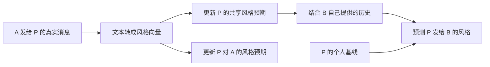

# Beyond the Dyad · 跨伙伴语言风格迁移的建模方案

项目研究的是**一个人收到某种表达方式后，自己的多维风格怎样变化，以及这种变化会不会带到其他伙伴那里**。每个玩家在每个时间点有一份可更新的风格向量。模型从真实消息中学习，再预测这个玩家下一条发出消息的风格向量。候选维度事先定义，哪个维度变化最大由训练阶段的分析提出，再用留出游戏检验。主假设检验的是整组维度上的迁移。

## 1. 一条消息就是一次可观察的经历

设 P 为我们正在预测的人，A 为风格来源，B 为当前的另一个伙伴。在同一场游戏里，按 `absolute_message_index` 合并各双人对话。`A → P` 给 P 一条输入，`P → B` 是 P 的产出，也是 B 随后可用的一条输入。预测任何消息时，先读发送者在该消息之前的状态。观察到真实消息后，才把其风格写入收信人的历史。

| 一行分析数据中的信息 | 用途 |
| --- | --- |
| `game_id`、消息序号、发信人、收信人 | 重建先后次序以及每人实际可接触的消息 |
| 原文、编码后的风格向量、各维度的计数分母或有效标记 | 将同一条消息作为发信人的产出和收信人的输入 |
| 游戏阶段、此前可见的交流内容或局势信息 | 控制不同语境下本来就会出现的表达差异 |

用 `(game_id, player)` 定义身份。来自 A 的输入指 A 发给 P 的私信。数据中的消息序号提供发送先后，实际读取时刻与处理时长需要另外的记录。现有语料的 12 场游戏提供模型比较所需的交错对话，测量验证还要确认各类表达的覆盖和变异。[Diplomacy 论文](https://aclanthology.org/2020.acl-main.353/) · [语料字段说明](https://convokit.cornell.edu/documentation/diplomacy.html) · [项目数据](https://github.com/HanesSue/Beyond-the-Dyad-Linguistic-Style-Transfer-Across-Conversational-Partners/tree/main/datasets/diplomacy)

## 2. 把风格表示成多维向量

第一版从约 12–20 个可核查的特征起步，覆盖不同类型的表达。维度的纳入依据是**能否稳定测量、能否与内容区分、在训练语料中是否有足够变异**。这一步保留多个方向，避免因为先验猜测而只追踪一个句式。

| 特征组 | 可选分量 | 分母或适用范围 |
| --- | --- | --- |
| 人称与功能词 | 第一人称单数、第一人称复数、第二人称、否定词、连词 | 按词数计算频率 |
| 情态与立场 | 情态助动词、缓和表达、确定性标记 | 按词数或分句数计算。保留具体形式供核查 |
| 句法形式 | 情态疑问结构、条件从句、直接祈使结构、去内容后的短词性序列 | 按可判定的分句或相关表达机会计算 |
| 书写形式 | 缩约、问号、感叹号、破折号 | 按适当机会或句子数计算 |

例如，`Could you support Munich?` 和 `Could you cover Belgium?` 的行动和地点不同，情态疑问结构相同。`Could you support Munich?` 和 `Please support Munich.` 的目标行动相近，表达形式不同。对语料先统一国家、地名、行动代码等内容标记，再提取功能词和结构特征。保留缩约和标点等计划测量的原始线索。按预先指定的分母算频率，检查短消息中的不稳定分量。某维度没有适用机会时标记为缺失，观察到了机会且未出现该形式时才记为零。对极稀有、重复或近乎恒定的维度，用训练数据决定是否合并或剔除。[Doyle 与 Frank，2016](https://aclanthology.org/P16-1050/) · [Halvani 与 Graner，POSNoise](https://arxiv.org/abs/2005.06605)

编码器用以下两种配对来验证。**同内容、改表达**的配对应在改动维度上拉开。**换内容、留表达**的配对应在相同维度上保持接近。可以人工构造小批成对句子，并抽查 Diplomacy 中相同话语功能的真实片段。再检查向量是否仍主要随游戏阶段、地理话题或消息长度变化。词汇复用单独报告，以免把某个词的回声计为抽象结构复用。预训练风格嵌入可用同一套对照做敏感性分析，主模型使用可回查到原文的分量。[Wegmann、Schraagen 与 Nguyen，2022](https://aclanthology.org/2022.repl4nlp-1.26/) · [Doyle 与 Frank，2016](https://aclanthology.org/P16-1050/)

用训练集估计每个分量的尺度和语境均值，再把文本转换为相对于同类语境的标准化向量 $x\in\mathbb R^d$。同一映射同时用于输入和产出。基础语境可用发信之前已知的游戏阶段和对话历史。需要按请求、提议或情报分享比较时，可以另做话语功能分层，并记录标签如何获得。若话语功能来自对目标文本的人工判断，这部分是**给定话语功能时的风格比较**。在预测设置中，把从目标句式、用词或标点推导出的标签当作已知输入会造成泄漏。

## 3. 模型里存哪些向量

| 变量 | 对固定玩家 P 的含义 | 从哪里得到 |
| --- | --- | --- |
| $b_P$ | P 的个人风格基线 | 用早期发出的消息估计，样本少时向训练集的群体均值收缩 |
| $g_P$ | P 对本场交流环境的共享风格预期 | 由 P 收到的各伙伴消息更新其后验 |
| $\theta_{P,j}$ | P 认为伙伴 $j$ 的典型风格 | 由 $j$ 的消息和共享预期共同决定其后验 |
| $z_{P,t}$ | 时刻 $t$，P 自己的当前共享产出风格 | 由本人基线和共享预期合成 |
| $\tau^2$ | 模型预期不同伙伴可以偏离共享风格的程度 | 在训练或验证游戏上选择。较小值允许的伙伴差异较少 |
| $\rho$ | P 的表达随所学风格移动的幅度 | 用发出的消息拟合。第一版取值范围为 $[-1,1]$，正值代表靠拢，零值对应基线 |

这里把上一版的 **Beta–Bernoulli** 换成**层级高斯模型**。每个维度在标准化空间里用同一结构计算，第一版采用对角协方差和跨维共享的适应系数 $\rho$，参数数量随之减少。以下省略维度下标和 P 的下标：

$$
g\sim\mathcal N(b,v_0),\qquad
\theta_j\mid g\sim\mathcal N(g,\tau^2),\qquad
x_i\mid\theta_j\sim\mathcal N(\theta_j,r_i),\quad i\text{ 来自 }j.
$$

初始用本人的基线作为共享预期的锚点。$v_0$ 控制先验对这个锚点的约束，$r_i$ 表示该观察的噪声。第一版可固定 $v_0$，用训练数据设定各分量的 $r_i=r$，再比较少量 $\tau^2/r$ 的候选值。后续可让分母很小的分量具有较大的 $r_i$，并检查同一谈判回合里多条相关消息是否被过度加权。高斯分布在这里近似标准化后的特征波动，适合先实现一套可逐步核查的更新。架构取自两个相邻的建模思路。Xu 与 Futrell 将句法经验组织成共享和动词特异的统计，Hawkins 等的 CHAI 比较跨伙伴的完全汇聚、分开学习和部分汇聚。本项目把它们迁移到**连续风格特征和玩家自己的产出**。[Xu 与 Futrell，2024](https://arxiv.org/html/2405.15964v1) · [Hawkins 等，Figure 7](https://cocosci.princeton.edu/papers/hawkinspartners.pdf)

## 4. 收到消息和发出消息时怎样更新

**收到消息。** 对每个有效维度，给消息来源 $j$ 累加两项统计。$W_j$ 是观测精度的和，$S_j$ 是按精度加权后的风格值之和。收到 $x_i$ 时，令 $W_j\leftarrow W_j+1/r_i$，$S_j\leftarrow S_j+x_i/r_i$。缺失分量跳过这次累加。对于已有观测的伙伴，令 $\bar x_j=S_j/W_j$，则

$$
\lambda_j=\frac{W_j}{1+\tau^2W_j},\qquad
\hat g=\frac{b/v_0+\sum_j\lambda_j\bar x_j}{1/v_0+\sum_j\lambda_j},\qquad
\hat\theta_j=\frac{\hat g+\tau^2 S_j}{1+\tau^2W_j}.
$$

三项都是当前时点的计算。对共享层而言，伙伴 $j$ 的样本均值 $\bar x_j$ 有两项不确定性，一项来自消息抽样 $1/W_j$，另一项来自伙伴偏离群体的程度 $\tau^2$。二者之和的倒数就是证据权重 $\lambda_j$。一个人发得越多，模型对他自己的风格越有把握。他对共享层的权重却会逐渐趋于上限，因为同一个人的许多消息依然只来自一个人。刚认识 B 时 $W_B=S_B=0$，所以 $\hat\theta_B=\hat g$。已经收到很多 B 的消息时，$\hat\theta_B$ 更接近 B 自己的平均向量。因此，**A 的消息可以改变共享预期，同时改变 P 对 B 的预期，且变化幅度取决于 B 自己提供了多少证据**。

**发出消息。** 在部分汇聚模型中，P 的共享产出状态和面向 B 的预期产出分别为

$$
z_{P,t}=b_P+\rho(\hat g_{P,t}-b_P),\qquad
\hat y_{P\to B,t}=z_{P,t}+\rho(\hat\theta_{P,B,t}-\hat g_{P,t}).
$$

第一式让 P 的风格随总体输入移动。第二式加上面向 B 的修正，合起来也可写作 $b_P+\rho(\hat\theta_{P,B,t}-b_P)$。实际发出的向量 $y_t$ 围绕 $\hat y_t$ 波动，用所有模型共有的高斯产出误差来打分。$z_{P,t}$ 是可以逐时点画出的当前风格向量，$\hat y_t$ 是模型对具体收信人和当前消息的预测。模型内的信念靠收到的消息更新，$\rho$ 靠真实产出拟合。可允许 $\rho$ 取负值，让拟合也能反映背离。

## 5. 同一段经历在不同模型里会发生什么

假设只看三个维度，分别是**缓和表达、第一人称复数、条件句**。所有数值都是示意用的标准化分数。P 的基线为 $(0,0,0)$。A 发给 P 的三条消息平均为 $(1.20,-0.60,0.80)$，B 发给 P 的三条消息平均为 $(0,0,0)$。对照历史中，把 A 的三条消息换成平均也为 $(0,0,0)$ 的三条消息。两段历史的消息数量和 B 的经历相同。

令 $v_0=\tau^2=r=1$，$\rho=0.5$。部分汇聚下，A 和 B 给共享层的权重都是 $3/(1+3)=0.75$。所以 P 的共享预期变成 $(0.36,-0.18,0.24)$，P 自己的共享产出向量变成 $(0.18,-0.09,0.12)$。B 有三条属于自己的证据，P 面向 B 时只保留共享层四分之一的偏移，因而预测 P 对 B 的表达为 $(0.045,-0.023,0.030)$，四舍五入到三位小数。

| 竞争模型 | 实际读取哪份经验 | 有 A 风格暴露时，P → A | 有 A 风格暴露时，P → B |
| --- | --- | --- | --- |
| **基线** | P 个人基线，已处理可见语境 | $(0,0,0)$ | $(0,0,0)$ |
| **伙伴特异** | 每位伙伴有独立先验 $\mathcal N(b_P,v_0)$，只用该伙伴的历史更新 | $(0.450,-0.225,0.300)$ | $(0,0,0)$ |
| **完全汇聚** | 把所有来源视为同一个 $g_P$，用其后验均值预测每个对象 | $(0.257,-0.129,0.171)$ | $(0.257,-0.129,0.171)$ |
| **部分汇聚** | 共享预期和当前伙伴历史共同决定预测 | $(0.495,-0.248,0.330)$ | $(0.045,-0.023,0.030)$ |

在对照历史中，四种模型对两个对象的预测都为零向量。看**相同语境、同一收信人**在两段历史之间的变化，就能区分迁移与 P 对某个对象一直采用的表达方式。这个例子用三维便于手算，实际模型同时更新全部保留维度。表中系数和向量都是模拟设定。

## 6. 用真实产出来比较模型

1. **冻结测量。** 以整场游戏划分数据。先用训练游戏验证编码和确定维度、尺度、先验及可评分的时点。用验证游戏选择少量超参数，确定后在测试游戏上运行。对每个游戏内玩家，用固定的早期校准规则估计 $b_P$，例如取最早若干条有效的本人消息，再从这个截点回放后续消息。四种模型使用同一截点和同一批评分目标。
2. **顺序拟合和预测。** 所有模型共享语境和产出误差的设定，各自在训练游戏上选择使真实产出预测对数分数最高的 $\rho$。在固定的高斯误差下，这一步等价于最小化有效维度上的加权平方误差。逐条预测留出游戏。每次只用此前已经观察到的文本和身份，预测后才把真实消息交给下一步更新。估计玩家基线时也只读允许的早期历史。
3. **把跨伙伴迁移作为主比较。** 在 P 给 B 的消息上，比较伙伴特异模型与两个允许共享的模型，主指标是各消息有效维度上的预测对数分数。按游戏汇总分差，并单独呈现存在清楚跨伙伴输入的时段。再做方向检查。用 A 在当前消息之前的风格与 P 基线的差定义方向，将真实产出相对伙伴特异模型的预测残差投影到这个方向上。正投影表示 P 的产出比该模型预计的更偏向 A。分别报告同源和跨源结果，并在同类语境、B 的近期输入相近的条件下复查。样本较少时，按游戏给出结果比把全部消息视为独立重复更贴近证据规模。
4. **用两个固定输入的模拟检验模型。** 第一组固定 B 的经历、语境及总暴露量，只改变 A 输入的向量，测量 P → B 的预测变化。第二组固定总体向量分布，把目标风格在 A 和 B 之间重新分配，观察同一收信人的预测是否随来源变化。还可以把相同输入集中在一人或分散给多人，检验部分汇聚对来源数量的独特预测。这些操作借鉴了 Ostrand 与 Ferreira 实验四对总体暴露与来源分布的区分。[Ostrand 与 Ferreira，2019，实验四](https://rostrand.github.io/papers/Ostrand_Ferreira.2019-JML.pdf)

**如何确定哪个维度变化最明显。** 主分析用整个向量检验迁移。训练阶段可以按游戏交叉验证，比较各维度的标准化变化幅度，以及跨伙伴历史给各维度带来的预测改善。把少数候选维度或特征组连同预期方向固定下来，再到测试游戏复核。若后续需要估计不同分量各自的适应强度，可把单一 $\rho$ 扩展成向总体收缩的 $\rho_k$，并检查参数能否在模拟中被恢复。这样可以把某一维度的偶然极值与跨游戏重复出现的变化区分开。

**怎样解释结果。** 共享模型在留出游戏中预测更好，且 P 对 B 的变化沿着 A 的风格方向，支持用共享经验解释这批产出。部分汇聚如果还更好地预测 P 对不同对象的差异，可以进一步报告迁移与伙伴特异调整并存。完全汇聚和部分汇聚的表现接近时，报告语料对两者区分的精度。外交谈判里的伙伴选择、局势和交流目的可能共同改变 A 的输入与 P 的产出，因此结果表述为在可观察语境和本人基线之外的**模型比较与行为证据**。Kronmüller 与 Guerra 对伙伴与情境的区分提供了问题起点，Ostrand 与 Ferreira 的产出实验提供受控参照。[Kronmüller 与 Guerra，2026](https://doi.org/10.1017/langcog.2026.10086) · [Ostrand 与 Ferreira，2019](https://rostrand.github.io/papers/Ostrand_Ferreira.2019-JML.pdf) · [Peskov 等，2020](https://aclanthology.org/2020.acl-main.353/)

## 7. 第一版的实现顺序

| 顺序 | 可交付结果 | 完成标准 |
| --- | --- | --- |
| 1. 风格测量 | 一张按时间排序的消息特征表和一份配对检查记录 | 同内容改形式时指标有响应，换内容保留形式时相应维度稳定。短消息和缺失分量有明确处理 |
| 2. 认知模型 | 四种模型共用的回放流程、逐时点状态和玩具输入 | 能重现上表的方向与数值，并在模拟数据上初步区分已知生成机制 |
| 3. 数据验证 | 逐场预测分数、A → P → B 的方向检查、候选维度复核 | 测试游戏此前未参与特征选择，结论有逐场结果和不确定性支撑 |

近期性可在主比较完成后加入。同一模型结构下，将早期和近期暴露等权的版本与按消息间隔衰减的版本比较，可以检验近期加权是否增加预测力。若要把结果归因于检索成本，需要能约束检索过程的额外证据。[Reitter、Keller 与 Moore，2011](https://homepages.inf.ed.ac.uk/keller/papers/cogsci_journal11.pdf)
